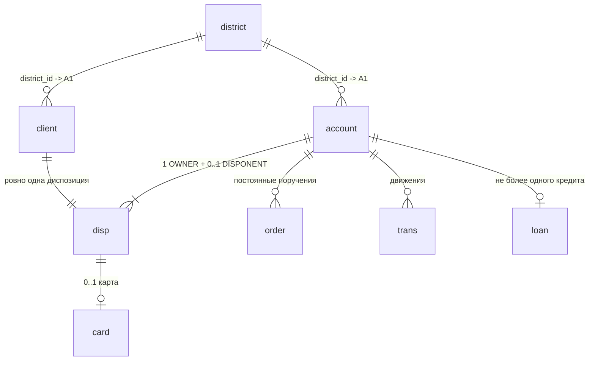

# Схема источника: Berka (PKDD'99)

Восемь таблиц чешского банка, 1993–1998.

**Что здесь проверено на файлах в `data/raw/`** (2026-09-21):
количества строк, кардинальности связей, перечни значений кодов и
их частоты, форматы дат и их диапазоны, пропуски, кодировка и
разделители, правило `birth_number`.

**Что взято из описания датасета и перевода с чешского** (и потому
требует независимой перепроверки): смысловые расшифровки кодов
(`k_symbol`, `loan.status`, `frequency`, `operation`) и легенда
колонок `A1`…`A16`. Легенда сверена с данными по строкам Праги и
Бенешова — сходится, но это косвенное подтверждение, а не источник.

## ER-диаграмма



Ключевой узел схемы — **`disp`** (disposition). Клиенты и счета
связаны не напрямую, а через неё, и именно она объясняет, почему
клиентов (5369) больше, чем счетов (4500): у счёта есть владелец
(`OWNER`) и, возможно, распорядитель (`DISPONENT`) — второй человек
с правом операций, но без владения.

## Таблицы

### `district` — районы (77 строк)

Колонки называются `A1`…`A16` — так в оригинальном датасете.
Легенда сверена со строками Праги и Бенешова.

| Колонка | Тип | Значение |
|---|---|---|
| `A1` | `int` | **PK**, код района |
| `A2` | `text` | название района |
| `A3` | `text` | регион |
| `A4` | `int` | число жителей |
| `A5` | `int` | муниципалитетов < 499 жителей |
| `A6` | `int` | муниципалитетов 500–1999 |
| `A7` | `int` | муниципалитетов 2000–9999 |
| `A8` | `int` | муниципалитетов > 10000 |
| `A9` | `int` | число городов |
| `A10` | `numeric` | доля городского населения, % |
| `A11` | `int` | средняя зарплата |
| `A12` | `numeric` | безработица '95 — **содержит `?`** |
| `A13` | `numeric` | безработица '96 |
| `A14` | `int` | предпринимателей на 1000 жителей |
| `A15` | `int` | преступлений '95 — **содержит `?`** |
| `A16` | `int` | преступлений '96 |

Пропуски: одна строка — район 69 (Jesenik), `A12` и `A15` равны `?`.
Наивный `COPY` в числовую колонку на ней упадёт.

### `client` — клиенты (5369)

| Колонка | Тип | Значение |
|---|---|---|
| `client_id` | `int` | **PK** |
| `birth_number` | `char(6)` | дата рождения + пол, см. ниже |
| `district_id` | `int` | **FK** → `district.A1` |

### `account` — счета (4500)

| Колонка | Тип | Значение |
|---|---|---|
| `account_id` | `int` | **PK** |
| `district_id` | `int` | **FK** → `district.A1` (район **отделения**, не клиента) |
| `frequency` | `text` | периодичность выписки |
| `date` | `int` → `date` | дата открытия, формат `YYMMDD` |

### `disp` — диспозиции (5369)

| Колонка | Тип | Значение |
|---|---|---|
| `disp_id` | `int` | **PK** |
| `client_id` | `int` | **FK** → `client` |
| `account_id` | `int` | **FK** → `account` |
| `type` | `text` | `OWNER` (4500) / `DISPONENT` (869) |

Проверено: у 3631 счёта одна диспозиция, у 869 — две. Каждый клиент
имеет ровно одну.

### `card` — карты (892)

| Колонка | Тип | Значение |
|---|---|---|
| `card_id` | `int` | **PK** |
| `disp_id` | `int` | **FK** → `disp`, уникален |
| `type` | `text` | `classic` (659) / `gold` (88) / `junior` (145) |
| `issued` | `text` → `date` | формат `YYMMDD 00:00:00` — **с временем**, в отличие от остальных дат |

Проверено: все 892 карты принадлежат диспозициям типа `OWNER`,
ни одной у `DISPONENT`.

### `loan` — кредиты (682)

| Колонка | Тип | Значение |
|---|---|---|
| `loan_id` | `int` | **PK** |
| `account_id` | `int` | **FK** → `account`, уникален (не более 1 кредита на счёт) |
| `date` | `int` → `date` | дата выдачи, `YYMMDD` |
| `amount` | `numeric` | сумма кредита |
| `duration` | `int` | срок, месяцев |
| `payments` | `numeric` | ежемесячный платёж |
| `status` | `char(1)` | исход, см. ниже |

### `order` — постоянные поручения (6471)

| Колонка | Тип | Значение |
|---|---|---|
| `order_id` | `int` | **PK** |
| `account_id` | `int` | **FK** → `account` |
| `bank_to` | `char(2)` | банк получателя |
| `account_to` | `text` | счёт получателя (внешний, не FK) |
| `amount` | `numeric` | сумма списания |
| `k_symbol` | `text` | назначение платежа |

### `trans` — транзакции (1 056 320)

| Колонка | Тип | Значение |
|---|---|---|
| `trans_id` | `int` | **PK** |
| `account_id` | `int` | **FK** → `account` |
| `date` | `int` → `date` | `YYMMDD` |
| `type` | `text` | направление, см. ниже |
| `operation` | `text` | тип операции, **183 114 пустых** |
| `amount` | `numeric` | сумма |
| `balance` | `numeric` | остаток на счёте после операции |
| `k_symbol` | `text` | назначение, **535 314 пустых** |
| `bank` | `char(2)` | банк контрагента, **782 812 пустых** |
| `account` | `text` | счёт контрагента |

Внимание на способ кодирования пустоты: `bank` пуст в 782 812 строках,
но записано это двумя разными способами — 760 931 раз поле просто
пустое, ещё 21 881 раз это `""` в кавычках. `k_symbol` использует три
формы: `""`, `" "` (пробел) и пустое поле. Любая проверка, считающая
только одну форму, даст заниженное число (см. AF-002).

Колонка `balance` — готовый остаток после каждой операции. На
неделе 17 (витрина `fct_account_balance_daily`) это ваш эталон для
сверки: собственный расчёт накопительной суммы обязан с ней сойтись.

## Закодированные поля

### `birth_number` — дата рождения и пол в одном числе

Формат `YYMMDD`, ровно 6 цифр (проверено: все 5369 значений).
К месяцу женщин прибавлено 50.

Проверка на данных: цифры позиций 3–4 образуют **две чистые полосы**
— `01`–`12` (2724 значения) и `51`–`62` (2645). Промежуточных
значений `13`–`50` нет ни одного, что подтверждает правило.

```
706213 -> 70 62 13 -> 62-50=12 -> женщина, 13.12.1970
450204 -> 45 02 04 ->            -> мужчина,  04.02.1945
```

Год двузначный, диапазон `11`…`87` — все клиенты рождены в XX веке,
префикс всегда `19`.

### Ловушка века при разборе (для недели 14)

Маска `to_date(birth_number, 'YYMMDD')` **молча даст неверный
результат для 4181 клиента из 5369** (78%). Правило Postgres для
двузначного года проверено на этой базе:

| Вход | `to_date(…,'YYMMDD')` | Верно |
|---|---|---|
| `69` | 2069 | — |
| `70` | 1970 | — |
| `450110` | **2045-01-10** | 1945-01-10 |
| `110820` | **2011-08-20** | 1911-08-20 |

Год `00`–`69` трактуется как 2000-е, `70`–`99` как 1900-е. Для наших
данных это значит: корректно разберутся только 1188 клиентов с годами
`70`–`87`, остальные получат даты на 100 лет вперёд, часть — в будущем.
Ни исключения, ни нарушения ограничений при этом не возникает.

Правильно: `to_date('19' || birth_number, 'YYYYMMDD')` — век задаётся
явно, а не выводится из эвристики драйвера.

### Коды-значения

| Поле | Значение | Смысл | Строк |
|---|---|---|---|
| `account.frequency` | `POPLATEK MESICNE` | ежемесячно | 4167 |
| | `POPLATEK TYDNE` | еженедельно | 240 |
| | `POPLATEK PO OBRATU` | после каждой операции | 93 |
| `trans.type` | `PRIJEM` | поступление | 405 083 |
| | `VYDAJ` | списание | 634 571 |
| | `VYBER` | снятие | 16 666 |
| `trans.operation` | `VKLAD` | взнос наличными | 156 743 |
| | `VYBER` | снятие наличными | 434 918 |
| | `PREVOD NA UCET` | перевод на другой счёт | 208 283 |
| | `PREVOD Z UCTU` | поступление с другого счёта | 65 226 |
| | `VYBER KARTOU` | снятие картой | 8 036 |
| | *(пусто)* | — | 183 114 |
| `k_symbol` | `POJISTNE` | страховой платёж | |
| | `SLUZBY` | оплата услуг банка | |
| | `UROK` | начисленные проценты | |
| | `SANKC. UROK` | штрафные проценты за просрочку | |
| | `SIPO` | коммунальные платежи | |
| | `DUCHOD` | пенсия | |
| | `UVER` | платёж по кредиту | |
| | `LEASING` | лизинг (только в `order`) | |
| `loan.status` | `A` | погашен без проблем | 203 |
| | `B` | закрыт, кредит не погашен | 31 |
| | `C` | действует, просрочки нет | 403 |
| | `D` | действует, есть просрочка | 45 |

`loan.status` — основа будущей целевой переменной: `B` и `D` —
дефолтные исходы, `A` и `C` — нет. Здесь же зарыто первое
«осторожно»: `A`/`B` — завершённые кредиты, `C`/`D` — открытые,
и смешивать их в одной метрике нельзя.

## Особенности загрузки

Проверено на файлах, всё это всплывёт при `COPY`:

1. **Разделитель `;`**, не запятая.
2. **CRLF** (`\r\n`) во всех файлах. `COPY ... FORMAT csv` справится,
   `FORMAT text` (по умолчанию) оставит `\r` хвостом в последней
   колонке каждой строки — молча, без ошибки.
3. **Кавычки `"` вокруг значений везде, кроме `district.csv`** —
   тот идёт без кавычек вообще.
4. **`?` вместо NULL** в `district.A12` и `A15` (одна строка).
5. **Даты — целые `YYMMDD`**, не даты. `930101` → 1993-01-01.
   Диапазон по всем таблицам: `930101` … `981231`.
6. **`card.issued` — исключение**: `931107 00:00:00`, с временем
   и как строка.
7. **Пустые значения в `trans`** оформлены непоследовательно и
   в пределах одной колонки: `k_symbol` бывает `""`, `" "` (пробел)
   и пустым полем; `bank` — пустым полем (760 931) и `""` (21 881).
   При загрузке все формы приводятся к `NULL` через
   `nullif(trim(col), '')`, иначе в витринах получится три разных
   «ничего».

## Денежные колонки

`loan.amount`, `loan.payments`, `order.amount`, `trans.amount`,
`trans.balance` — только `numeric`, никогда `float`, включая
промежуточные вычисления (правило проекта из `CLAUDE.md`).

## Контрольные числа для сверки после загрузки

| Таблица | Строк |
|---|---|
| `district` | 77 |
| `client` | 5 369 |
| `account` | 4 500 |
| `disp` | 5 369 |
| `card` | 892 |
| `loan` | 682 |
| `order` | 6 471 |
| `trans` | 1 056 320 |
